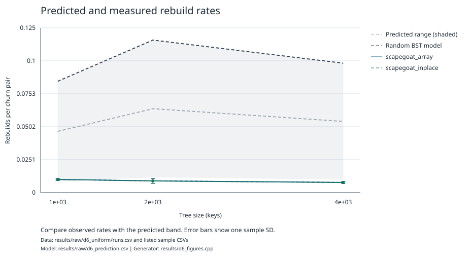
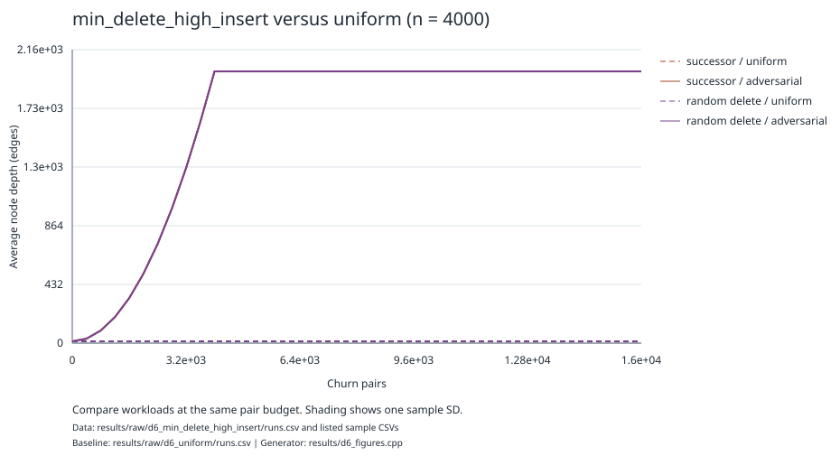
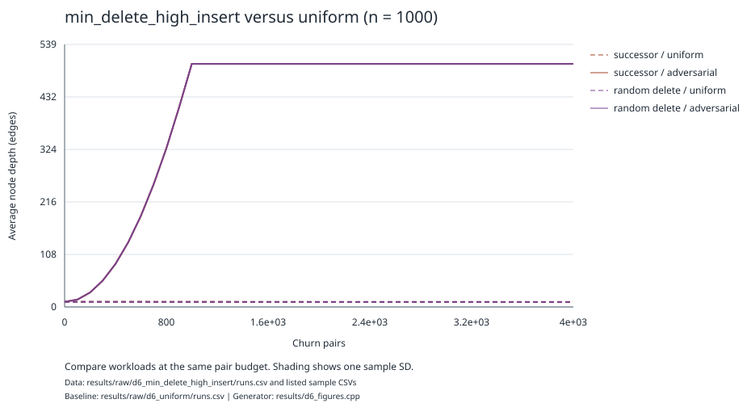
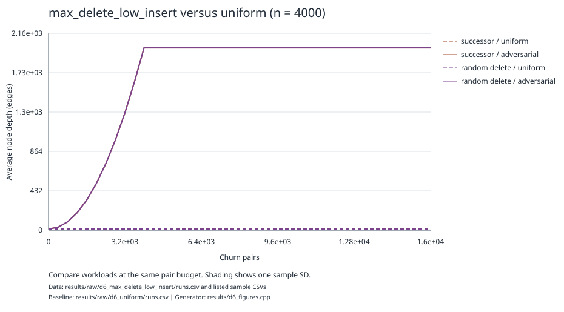
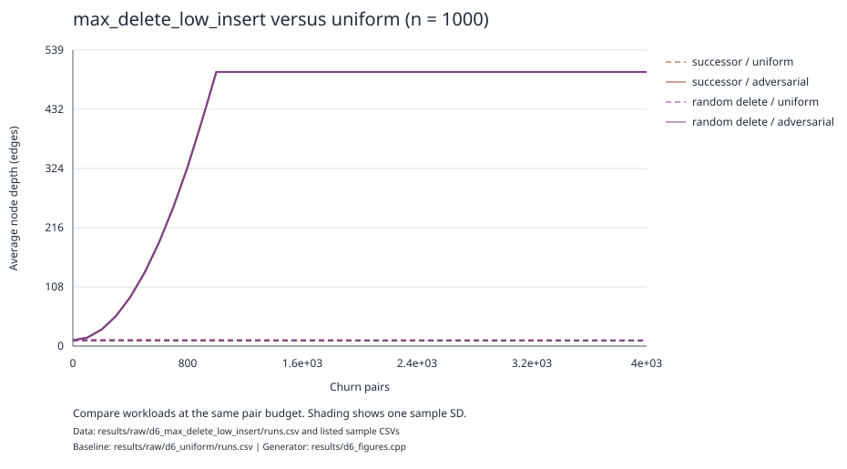
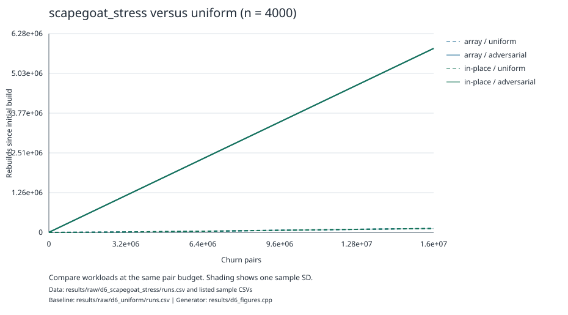
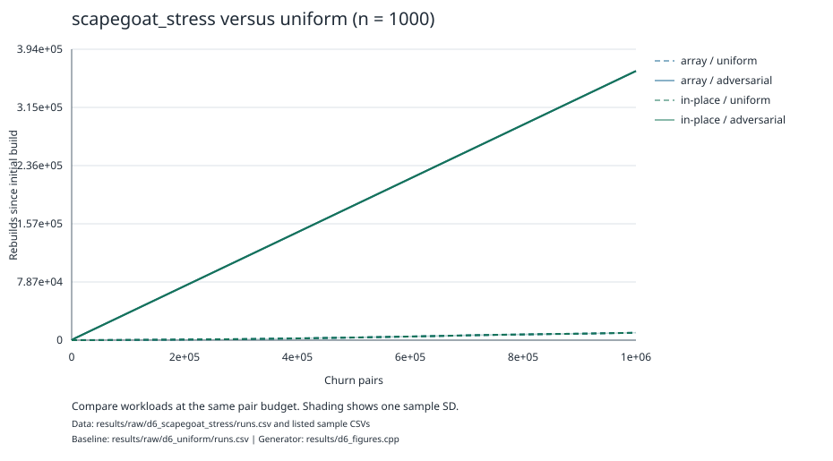

# Project 3 — Search Trees Under Long-Running Churn

## Team contributions

| Member | Contribution | Repository reference |
|---|---|---|
| Mayank Khoria (D1) | Iterative Hibbard BST and both deletion policies | [86dae75](https://github.com/godofwar1007/DSA-project/commit/86dae75) |
| Parth Pawar (D2) | Scapegoat tree, array and in-place rebuilds, and height validation | [424ca3c](https://github.com/godofwar1007/DSA-project/commit/424ca3c) |
| Eklavya (D3) | Shared interface, simulator integration, and independent RNG streams | [844c91c](https://github.com/godofwar1007/DSA-project/commit/844c91c), [3427486](https://github.com/godofwar1007/DSA-project/commit/3427486) |
| Tanush Bansal (D4) | Sorted-array oracle, differential runner, validation, and replay | [7dfca1e](https://github.com/godofwar1007/DSA-project/commit/7dfca1e) |
| Chetan Yogbharti (D5) | Adversarial schedules, workload runner, and schedule tests | [f484666](https://github.com/godofwar1007/DSA-project/commit/f484666) |
| Parth Kalia (D6) | Prediction model, benchmark workflow, measurements, and figures | [36b94da](https://github.com/godofwar1007/DSA-project/commit/36b94da) |

## Problem and application

The project studies whether a search tree gets deeper under repeated updates even when the number of stored keys stays fixed. We compare two Hibbard deletion policies, always choosing the successor and randomly choosing the predecessor or successor, against a scapegoat tree with array-based and in-place rebuilding. The simulator records mean node depth and rebuild counts over time. Under uniform churn, it runs at sizes 1,000, 2,000, and 4,000 for at least 1 million, 4 million, and 16 million delete–insert pairs respectively.

## Shared interface and invariants

The simulator and differential runner use the `churn::Dictionary` interface in `include/dictionary.hpp`. The factory selects the concrete implementation from the strategy name. Keys are integers and each dictionary holds at most one copy of a key. `insert` returns true only when a key is added, and `erase` returns true only when a key is removed. The corresponding unsuccessful updates preserve the state. `contains` checks membership and `size` returns the current number of keys. The `inorder` method appends the stored keys in ascending order so the test harness can compare the contents with the sorted-array oracle.

For a tree, the root has depth zero and a child's depth is one greater than its parent's. The internal path length is the sum of all node depths. The simulator divides this sum by the number of live keys to compute average depth. A successful search for a uniformly chosen stored key visits one more node on average, because the root counts as a visit. The tree implementations maintain the depth sum as they update. The sorted-array oracle returns zero for the depth sum because it has no tree shape. The rebuild counter is cumulative. Each subtree or whole-tree rebuild counts once, and the Hibbard trees return zero.

Both tree validators check strict BST ordering and stored subtree sizes. The Hibbard validator also compares the recomputed node count and depth sum with the cached values. The scapegoat validator checks the depth sum, the relation between current size and its recorded high-water size, and the height bound based on that high-water size. The differential harness checks return values and state against its oracle, and the simulator checks final size and calls the selected dictionary's validator before reporting success.

## Simulator design

The application in `app/simulator.cpp` takes a strategy, initial size and seed. The schedule defaults to uniform, and options can override the pair count, sampling interval and output destination. Numeric options must parse completely as unsigned integers. Invalid syntax or range errors are reported before simulation.

The simulator draws distinct initial keys from the integer range [0, 2³⁰) and inserts them in draw order. Its live-key vector supports indexed victim selection and removal by moving the last element into the victim's slot. A hash set tracks membership for duplicate rejection during workload generation. A schedule selects a victim and proposes a replacement. After removing the victim from the live set, the simulator retries insertion candidates until one is absent from that set. It then applies the selected erase and insert to the dictionary. The dictionary has n keys before and after each pair and n−1 between the two updates.

The RNG for initial keys and workload choices is seeded directly from the run seed. A second engine is deterministically derived from that seed for randomized Hibbard replacement. This separation matters because choosing a predecessor or successor consumes randomness inside the tree. With separate engines and independent live-key tracking, the same simulator build and workload parameters replay the same key operations across strategies. An unexpected failure to apply an already selected update stops the run so it cannot silently alter the operation stream.

Each CSV row records the strategy, initial size, seed, completed pair count, mean depth and cumulative rebuild count. The simulator samples the initial state, then every n pairs by default, and includes a final sample if the last pair falls between sampling points. Initial construction and final validation are outside the measured interval. The elapsed time covers workload generation, dictionary updates and sampled output.

The [D3 derivation](docs/derivations/D3_250001028.pdf) gives a conceptual comparison. A nonempty B-tree of minimum degree t with n keys has height at most log base t of ((n+1)/2). Its minimum occupancy and equal leaf depths keep the bound valid after each update. The simulator measures binary search trees, with the B-tree bound serving as a reference point in the discussion.

## Structure A — Hibbard BST

Each node stores an integer key, two child pointers, and its subtree size. Search follows one child at each comparison. Insertion walks to a null link and uses the search path to update ancestor counts. Deletion finds the incoming link to the target. If the node has at most one child, that child replaces it. If it has two children, the successor policy copies the minimum key on the right. The randomized policy can instead use the maximum key on the left. The selected replacement has at most one child, so the ordinary splice removes it from its old position.

The depth sum is updated with the depth of the removed node and the size of its promoted subtree. Each node in that subtree moves up one level. Copying a replacement key leaves the target node's position unchanged. Searches and updates use O(h + 1) time for height h. An update can store O(h + 1) path entries. A chain can make h = n − 1. The [D1 derivation](docs/derivations/D1_250001048.pdf) explains why each splice or replacement preserves key order.

## Structure B — Scapegoat tree

This tree stores subtree sizes and uses α = 2/3. The insertion path supplies both the prospective depth and the ancestors to inspect. When the depth exceeds floor(log base 3/2 of the new size), the code walks back toward the root and finds a parent whose child on the insertion path is too large. Rebuilding that parent's subtree reduces its height. The [D2 derivation](docs/derivations/D2.pdf) establishes that such a parent exists. On deletion, a nonempty tree rebuilds at the root when its size falls below two thirds of the recorded high-water size.

The array mode collects pointers in inorder and reconnects the existing nodes into a balanced shape. It uses O(m) scratch space for a subtree of m nodes. The in-place Stout–Warren mode rotates the subtree into a rightward vine and compresses it with left rotations. The rotations maintain sizes and account for changes to the depth sum. Each mode takes O(m) time to rebuild. The in-place rebuild uses constant auxiliary space for its rotation work. The amortized update guarantee and the measured rebuild rates are discussed below.

## Correctness and regression tests

The oracle stores sorted distinct keys in a vector. Binary search gives membership and locates the position for insertion or erasure. The differential harness applies each operation to the tree and oracle, compares return values and membership, and then checks size, sorted contents, tree invariants, and rebuild-count behavior. It seeds all four implementations with a reproducible operation sequence. The normal and adversarial runs use seed 20260928 and one million operations per strategy. A replay fixture covers empty operations, duplicate keys, extreme integer keys, deletion cases, and draining a tree. Additional tests deliberately corrupt metadata to verify that the tree validators detect it.

The harness exports replayable operation sequences. Its shrinker removes chunks and keeps a shorter sequence when the same failure still occurs. It reduces the chunk size to one operation, allowing the test to check whether each remaining operation is needed to reproduce the error.

| Module | Issue and regression coverage | Fix |
|---|---|---|
| Hibbard | The removal path included the erased node during size updates. Deletion checks exercise leaf and one-child splices and validate subtree sizes. | [8ca238d](https://github.com/godofwar1007/DSA-project/commit/8ca238d) |
| Scapegoat | The validator's depth limit used current size and an extra level. A focused regression checks the bound based on the high-water size. | [c0bd48d](https://github.com/godofwar1007/DSA-project/commit/c0bd48d) |
| Simulator | Sharing workload randomness with randomized deletion could change later workload keys. Numeric parsing also accepted trailing characters. Separate engines and full-token parsing address both issues. | [3427486](https://github.com/godofwar1007/DSA-project/commit/3427486) |

## Adversarial workload design

The two Hibbard schedules repeatedly delete one extreme and insert from the opposite end of the key universe. One deletes the minimum and draws decreasing high-end keys. The other deletes the maximum and draws increasing low-end keys. These streams replace the original keys with a monotone insertion sequence that can form a chain. Deleting an extreme bypasses the two-child deletion case, so this workload can degrade both Hibbard policies. A chain on n nodes has depths 0 through n − 1 and mean depth (n − 1)/2.

The scapegoat stress schedule deletes a uniformly selected live key and inserts a fresh key from an increasing low-end sequence. The ordered insertions repeatedly extend a search path and can cross the depth threshold. The benchmark uses the same seeds and schedules across the applicable strategies. The results below compare the stress runs with their uniform controls. The [D5 derivation](docs/derivations/D5_250001023.pdf) gives the argument for the chain and distinguishes the published exact-fit model from ordinary random churn.

## D6 experiment setup

The Release C++17 simulator ran all workloads on the same Windows 11 x64
machine with an Intel Core i7-13650HX. Windows reported 11,776 KiB L2 and
24,576 KiB L3. The compiler was Clang 22.1.8, bundled with Zig 0.17.1,
using `-std=c++17 -O2 -DNDEBUG -Wall -Wextra -Wpedantic`.
The [environment record](results/raw/d6_environment.txt) includes the source revision.

Each condition used seeds 20261117 through 20261121. For each seed and size,
all strategies started with the same random keys. Within a schedule they
received the same sequence of workload operations. A pair consists of a
deletion and an insertion, with size fixed at n between pairs. Initial
construction is outside the timed interval. The timer covers workload
generation, dictionary updates and sampled CSV output. Error bands and
the reported ± values are sample standard deviations across the five seeds.

Uniform churn and scapegoat stress ran for 1,000,000, 4,000,000 and
16,000,000 pairs at n = 1000, 2000 and 4000, respectively. The two
extreme-key Hibbard workloads ran for 4n pairs. This covers four
turnovers of the live set and captures the formation and persistence of
the chains. The uniform control for those workloads uses the first 4n
pairs of the full run. The simulator counts two successful dictionary
updates per pair. Rebuilds during initial construction are subtracted
from all reported churn rebuild counts.

## D6 predicted costs

The [pre-measurement model](docs/predictions_analysis/D6_prediction.md) was
first recorded in [f994b56](https://github.com/godofwar1007/DSA-project/commit/f994b56)
and evaluated at the implementation's α = 2/3 in
[36b94da](https://github.com/godofwar1007/DSA-project/commit/36b94da).
The [derivation](docs/derivations/D6_250001054.pdf) uses a potential
proportional to the sum of child-size imbalances beyond one. An ordinary
update increases it by O(log n). A scapegoat has imbalance proportional to
its subtree size, so restoring balance releases enough potential to pay
the linear rebuild cost. Deletion-triggered shrink rebuilds are charged
to the deletions since the last size high-water mark.

The frequency model substitutes the leaf-attachment depth distribution
of a randomly built BST for the true distribution under scapegoat churn.
For a threshold h = floor(log base 3/2 of n), the model probability r is
the mass above h. The pre-measurement heuristic put the observed rate
between 0.1r and r. A shrink-triggered rebuild needs n − 1 < (2/3)n, which
cannot occur at the experimental sizes. Insertion can trigger a rebuild
at the root.

## D6 results

### Uniform depth

| Keys | Successor, initial | Successor, final | Random replacement, final | Scapegoat, final |
|---:|---:|---:|---:|---:|
| 1,000 | 10.58 ± 0.29 | 14.43 ± 1.50 | 9.51 ± 0.27 | 10.89 ± 0.82 |
| 2,000 | 11.94 ± 0.33 | 17.77 ± 0.73 | 10.63 ± 0.31 | 11.31 ± 0.29 |
| 4,000 | 13.31 ± 0.34 | 23.93 ± 2.13 | 11.94 ± 0.33 | 12.87 ± 0.68 |

Depth is in edges, with the root at zero. Both Hibbard policies have
the same initial mean at each size. Always-successor deletion increased
mean depth at every tested size. Random replacement ended shallower than
its initial tree, and the two scapegoat modes stayed close to their
initial means. The always-successor drift agrees qualitatively with
Eppinger's experiments. The three sizes and finite runs do not establish
a square-root scaling law for ordinary random churn. The Culberson–Munro
result concerns a restricted exact-fit-domain update model.

### Scapegoat rebuild frequency

| Keys | Model per 1,000 pairs | Observed per 1,000 pairs | Observed/model | Seeds within predicted band |
|---:|---:|---:|---:|---:|
| 1,000 | 84.81 | 10.01 ± 0.73 | 11.8% | 5/5 |
| 2,000 | 116.19 | 8.89 ± 1.89 | 7.6% | 1/5 |
| 4,000 | 98.59 | 7.72 ± 0.78 | 7.8% | 0/5 |

The model predicted 8.5 to 13.1 times as many rebuilds as the mean
observed rate. The heuristic lower bound missed four seeds at n = 2000
and all five at n = 4000. The random-BST approximation ignores the
effect of previous rebuilds on the shape encountered by the next
insertion. That is a plausible explanation for the overestimate.
The array and in-place variants had identical average depth and
rebuild counts at every sample for all 15 matched uniform runs and
all 15 matched stress runs.

[Per-seed comparison](results/figures/d6_uniform/rebuild_comparison.csv)

### Adversarial workloads

With either extreme-key Hibbard schedule, both policies ended at mean
depths 499.5, 999.5 and 1999.5 edges, with zero observed spread.
Those are exactly the depths of a chain. The always-successor uniform
controls at the same pair counts ended at 10.13, 11.48 and 12.87 edges.
The two Hibbard policies converge on this workload because deleting an
extreme never requires a two-child replacement choice.

 ·

Scapegoat stress deletes uniformly and inserts monotonically from the
low end. It produced about 364 rebuilds per 1,000 pairs at every size,
roughly 36×, 41× and 47× the matched uniform rates. At n = 4000,
end-of-run mean depth was 13.57 ± 0.45 edges under stress. The array
variant took 13.67 ± 0.12 seconds and the in-place variant took
11.88 ± 0.17 seconds for the 16 million pairs. In uniform churn at the
same size they took 9.59 ± 0.06 and 10.09 ± 1.03 seconds, respectively.
These are end-to-end timings for this machine.

 ·
[Uniform timing summary](results/figures/d6_uniform/timing_summary.csv) ·
[Stress timing summary](results/figures/d6_scapegoat_stress/timing_summary.csv)

## D6 reproducibility and limitations

The [benchmark instructions](bench/README.md) give the C++ build and
regeneration commands. The four raw directories under
[`results/raw/`](results/raw/) contain the run manifests and seeded
sample series. `bash scripts/run_all.sh --figures-only` regenerates the
plots and comparison tables.

Hardware cache profiling was attempted separately with the Windows
Performance Recorder using the CacheMisses hardware counter. The machine
denied enabling the system-profiling policy (0xc5585011). The timing data
support elapsed-time comparisons on this configuration. Cache misses
were unavailable. See [Microsoft's PMU recording documentation](https://learn.microsoft.com/en-us/windows-hardware/test/wpt/recording-pmu-events).

### References

- I. Galperin and R. L. Rivest, “Scapegoat Trees,” SODA, 1993.
- Q. F. Stout and B. L. Warren, “Tree Rebalancing in Optimal Time and Space,” Communications of the ACM 29(9), 1986.
- J. L. Eppinger, “An Empirical Study of Insertion and Deletion in Binary Search Trees,” Communications of the ACM 26(9), 1983.
- J. Culberson and J. I. Munro, “Analysis of the Standard Deletion Algorithms in Exact Fit Domain Binary Search Trees,” Algorithmica 5, 1990.
